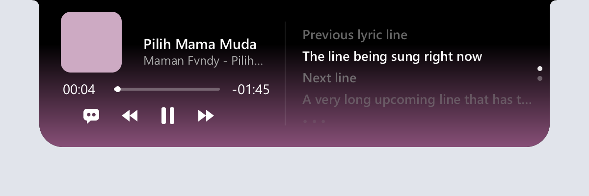
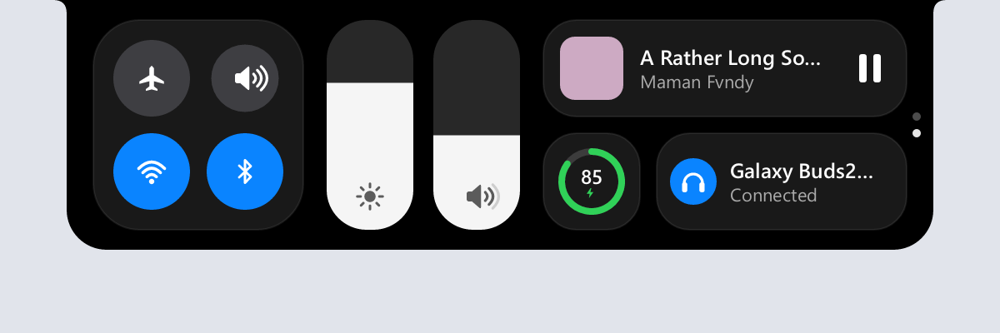
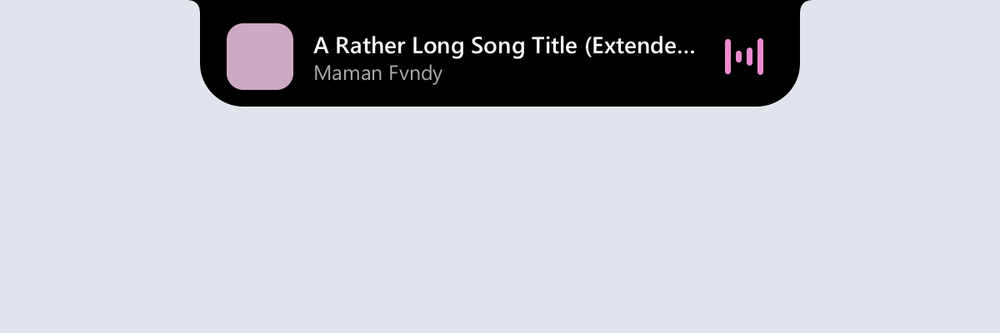
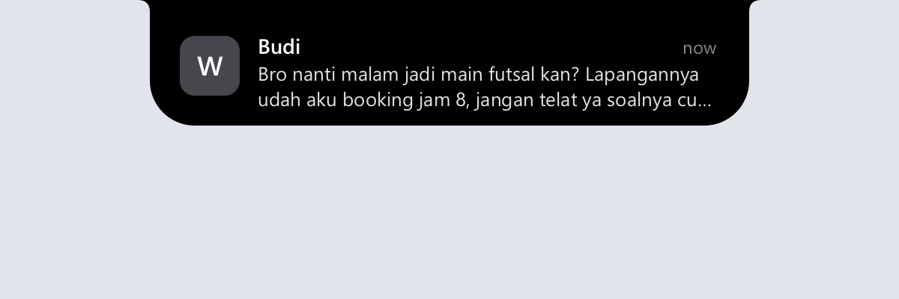
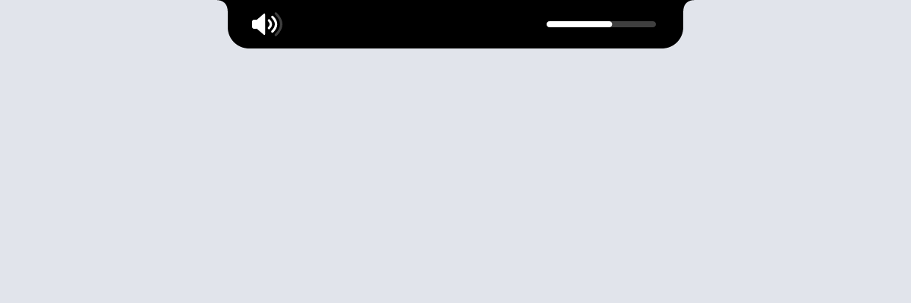
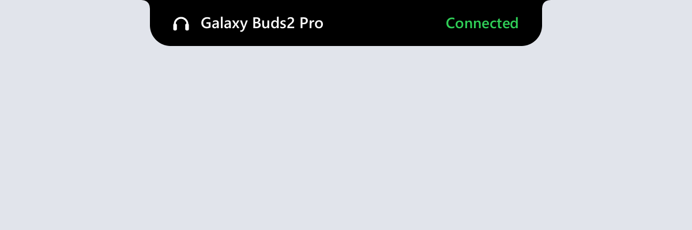

# notch-woy

A Dynamic Island for Windows, written in Rust. A small black notch sits at the
top of your screen, shows what is playing and your battery, and opens into a
media player, synced lyrics, and a Control Center when you hover it.



## Features

- **Now playing** from any app that reports to Windows (Spotify, browsers,
  Media Player…): cover art, title, artist, a draggable progress bar, and
  previous / play-pause / next.
- **Synced lyrics** from [LRCLIB](https://lrclib.net), scrolling with the song,
  over a gradient in the cover's color.
- **Control Center** (scroll down on the open notch): Wi-Fi, Bluetooth,
  airplane mode and mute toggles, brightness and volume sliders, and Now
  Playing, battery and Bluetooth modules. Brightness also drives external
  monitors that support DDC/CI.
- **Alerts** that grow out of the notch for:
  - a new track, with an equalizer in the cover's color;
  - charger plugged in or out, low battery (20%, 10%), fully charged;
  - volume and mute changes — these replace Windows' own volume pop-up;
  - Bluetooth devices connecting and disconnecting;
  - app notifications (WhatsApp, mail…) — click one to open the app.
- **Indicators** on the resting notch: battery level and a connected
  Bluetooth device.
- **Stays out of the way**: shrinks to a thin pill when a maximized window's
  title bar or tabs sit under it, and hides for full-screen games and video.

| Resting | Control Center |
|---|---|
|  |  |
| **New track** | **Notification** |
|  |  |
| **Volume** | **Bluetooth** |
|  |  |

The screenshots are rendered from sample data.

## Install

1. Download `notch-woy-v0.1.0-windows-x64.zip` from
   [Releases](https://github.com/Panskuy/notch-woy/releases).
2. Unzip it anywhere and run `notch-woy.exe`.

It starts at login from then on. To turn that off, or to quit, use the
notch-woy icon in the notification area of the taskbar.

Windows may warn about an unrecognized app the first time, since the exe is
not code-signed: choose **More info → Run anyway**.

Requires Windows 10 or 11, 64-bit.

## Using it

| Do this | To |
|---|---|
| Hover the notch | Open it |
| Scroll down / up on the open notch | Switch between the player and Control Center (a touchpad drags the pages along) |
| Click or drag the progress bar | Seek |
| Click 💬 | Show or hide lyrics |
| Click a notification | Open the app that sent it |
| Tray icon → Start at login / Exit | Autostart, quit |

## Good to know

- **Windows' own notification banners still show.** To see notifications
  only in the notch, open *Settings → System → Notifications → (the app)*,
  turn off **Show notification banners** and leave **Show notifications in
  notification center** on.
- **Privacy**: to find lyrics, the title, artist, album and length of the
  playing track are sent to lrclib.net. Notification contents are read and
  shown locally and never leave your machine.
- **Volume keys** are handled by notch-woy while it runs, so Windows' own
  volume pop-up stays hidden; they go back to Windows when it exits. Laptop
  Fn keys driven by the maker's own software, and headset buttons, may still
  show their own pop-ups.
- **Airplane mode** turns Wi-Fi and Bluetooth off; Windows' own airplane mode
  is not open to apps.
- **External monitor brightness** needs DDC/CI, which some monitors have off
  in their on-screen menu.
- New notifications are checked every 0.7 s and Bluetooth connections every
  2 s, so they can appear slightly after Windows shows them.

## Building from source

Needs the Rust MSVC toolchain and the Windows SDK (for `rc.exe`, which embeds
the icon).

```
cargo build --release
```

The exe is `target/release/notch-woy.exe`. `cargo run` starts a debug build
with a console for logs; debug builds never turn autostart on by themselves.

`cargo test` runs the unit tests. Tests marked `#[ignore]` render previews to
`target/*.png` or talk to the real system (`cargo test <name> -- --ignored`).

## License

[MIT](LICENSE)
