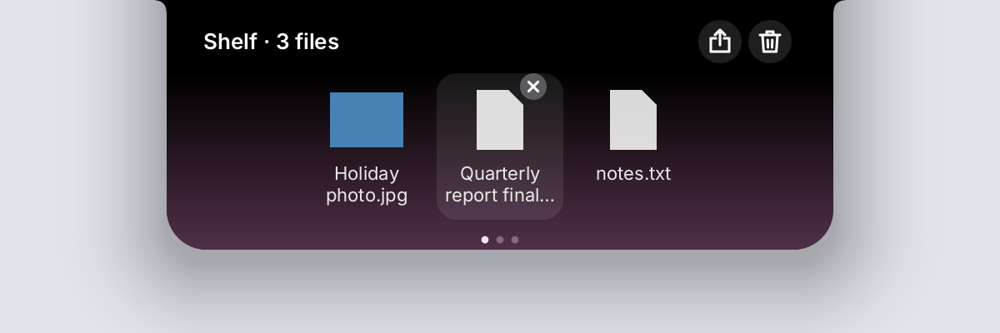
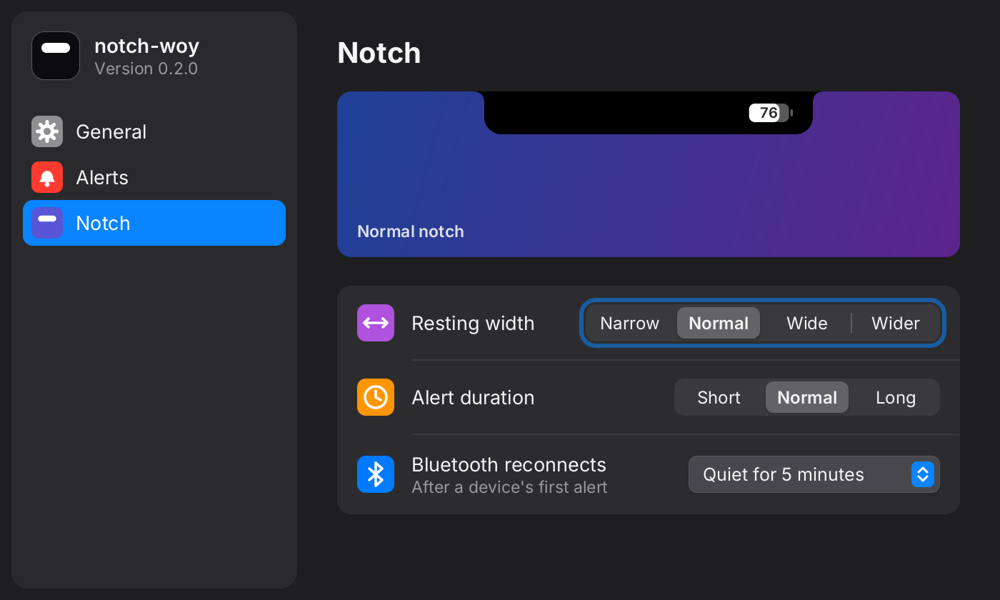
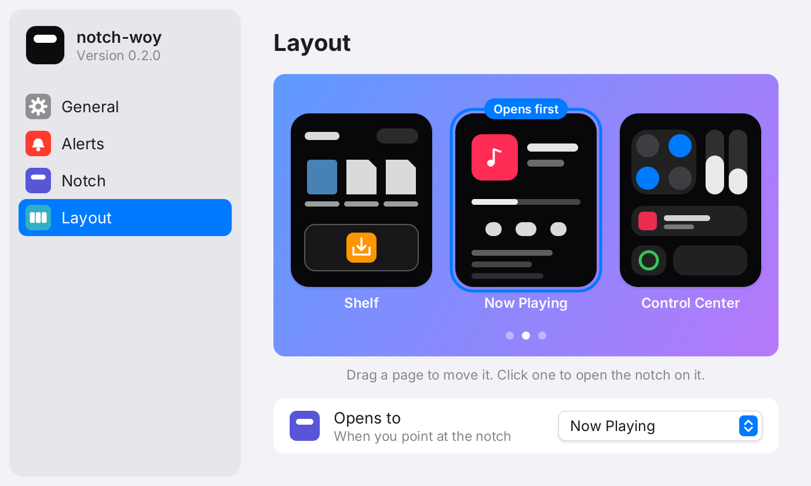

# notch-woy

A Dynamic Island for Windows, written in Rust. A small black notch sits at the
top of your screen, shows what is playing and your battery, and opens into a
media player, synced lyrics, and a Control Center when you hover it.


## Features

- **Now playing** from any app that reports to Windows (Spotify, browsers,
  Media Player…): cover art, title, artist, a draggable progress bar, and
  previous / play-pause / next.
- **Audio output picker** in the player: switch between speakers, headphones
  and monitors without opening Windows' sound settings.
- **Synced lyrics** from [LRCLIB](https://lrclib.net), scrolling with the song
  and lighting up word by word as it is sung (by the lyrics' own word timings
  when they have them, else spread over the line),
  over a gradient in the cover's color that stays behind the other pages
  too.
- **Control Center** (swipe left on the open notch, the page on the right): Wi-Fi, Bluetooth,
  airplane mode and mute toggles, brightness and volume sliders, and Now
  Playing, battery and Bluetooth modules (the connected device's battery
  too). Brightness also drives external monitors that support DDC/CI; with
  more than one screen, its symbol becomes a pair of screens that opens a
  Displays sheet with each screen's own slider (as on a Mac).
- **Alerts** that grow out of the notch for:
  - a new track, with an equalizer in the cover's color that moves to the
    music actually playing (the resting notch's equalizer too);
  - charger plugged in or out, low battery (20%, 10%), fully charged;
  - volume and mute changes — these replace Windows' own volume pop-up;
  - Bluetooth devices connecting (with their battery level, when Windows
    reports one: most earbuds, headsets and Bluetooth LE keyboards and mice)
    and disconnecting;
  - app notifications (WhatsApp, mail…) — click one to open the app.
- **Clock** on the resting notch, on the left like the iPhone's status bar,
  in your Windows time format (12 or 24 hours).
- **Indicators** on the resting notch: battery level and a connected
  Bluetooth device.
- **File shelf** (swipe right on the open notch, the page on the left): drag files onto the notch
  to keep them at hand, then drag them out where they should go (Explorer
  moves them within a drive, copies across), open them, or share them with
  Windows' Share sheet. The shelf points at the files; nothing is copied
  until you drag one out.
- **Stays out of the way**: shrinks to a thin pill when a maximized window's
  title bar or tabs sit under it, and hides for full-screen games and video.

| Resting | Control Center |
|---|---|
|  |  |
| **New track** | **Notification** |
|  |  |
| **Volume** | **Bluetooth** |
|  |  |
| **Shelf** | |
|  | |

**Settings** (tray icon → Settings…), in light or dark to match Windows:



Under **Layout**, the pages are cards, as when arranging Home Screen pages
on an iPhone: drag one sideways to move it, click one to open the notch on
it:



The screenshots are rendered from sample data.

## Install

1. Download `notch-woy-v0.3.0-windows-x64.zip` from
   [Releases](https://github.com/Panskuy/notch-woy/releases).
2. Unzip it anywhere and run `notch-woy.exe`.

It starts at login from then on. To turn that off, or to quit, use the
notch-woy icon in the notification area of the taskbar.

Windows may warn about an unrecognized app the first time, since the exe is
not code-signed: choose **More info → Run anyway**.

Requires Windows 10 or 11, 64-bit.

## Using it

| Do this | To |
|---|---|
| Hover the notch | Open it |
| Swipe sideways on the open notch (touchpad, tilt wheel), or turn the mouse wheel | Switch between the pages: the shelf, the player and Control Center, in the order set under Settings → Layout (that order by default); the wheel turns down to the right. A touchpad drags the pages along |
| Drag files onto the notch | Put them on the shelf (it opens as a drop zone) |
| On the shelf: drag a file out / click it / its × | Move or copy it there / open it / take it off the shelf (the file stays) |
| On the shelf: Share / Clear All | Share every file on it / take them all off (thrown into the bin; the files stay) |
| On the shelf: mouse wheel | Scroll through the files, then on to the player |
| Click or drag the progress bar | Seek |
| Click 💬 | Show or hide lyrics |
| Click the output button (right of the player's controls) | Pick the speakers, headphones or monitor to play through |
| Click a notification | Open the app that sent it |
| Control Center: the Now Playing module (off its play button) | Go to the player |
| Control Center: the screens symbol under brightness (two or more screens) | Set each screen's brightness on its own; tap off the sheet to close it |
| Tray icon → Settings… | Turn each kind of alert on or off, show alerts shorter or longer, make the resting notch narrower or wider, make the open notch (on hover) Compact, Normal or Large, set how long a reconnecting Bluetooth device stays quiet. Changes apply at once |
| Tray icon → Start at login / Exit | Autostart, quit |
| Run `notch-woy.exe --settings` | Open Settings right away (from a shortcut, say) |

## Plugins

Turn on **Plugins** in Settings → General, then put scripts in the folder
its **Open Folder** button opens (`%LOCALAPPDATA%\notch-woy\plugins`). The
format follows [xbar](https://xbarapp.com) and
[SwiftBar](https://github.com/swiftbar/SwiftBar): a file named
`{name}.{interval}.{ext}` (`.ps1`, `.cmd`, `.bat`, `.py` or `.exe`; interval
like `30s`, `10m`, `1h`, at least 5 s) runs on that schedule, and whatever it
prints becomes an alert when it changes:

```powershell
# weather.10m.ps1
$t = (Invoke-RestMethod "https://wttr.in/?format=%t").Trim()
"Outside: $t | href=https://wttr.in"
"---"
"Updated $(Get-Date -Format t)"
```

The first line (before `---`) is the title; `href=` is opened when you click
the alert; the first line after `---` shows under the title. Plugins run as
you, in their own windowless processes, and are stopped after 10 s; only
put scripts there that you trust.

## Good to know

- **Windows' own notification banners still show.** To see notifications
  only in the notch, open *Settings → System → Notifications → (the app)*,
  turn off **Show notification banners** and leave **Show notifications in
  notification center** on.
- **Privacy**: to find lyrics, the title, artist, album and length of the
  playing track are sent to lrclib.net. Notification contents are read and
  shown locally and never leave your machine.
- **Volume keys** are handled by notch-woy while it runs, so Windows' own
  volume pop-up stays hidden; they go back to Windows when it exits, or
  when the volume alert is turned off in Settings. Laptop
  Fn keys driven by the maker's own software, and headset buttons, may still
  show their own pop-ups.
- **Airplane mode** turns Wi-Fi and Bluetooth off; Windows' own airplane mode
  is not open to apps.
- **External monitor brightness** needs DDC/CI, which some monitors have off
  in their on-screen menu.
- **Memory**: at rest notch-woy hands the pages it is not using back to
  Windows, so Task Manager shows about 3–5 MB.
- New notifications are checked every 0.7 s and Bluetooth connections every
  2 s, so they can appear slightly after Windows shows them.
- **Bluetooth alerts** skip devices that drop for a few seconds and come
  back (sleeping keyboards and mice). A device that keeps reconnecting
  alerts once, then stays quiet until it has settled for 5 minutes (change
  it under *Bluetooth reconnects* in Settings); the indicator still
  follows it.

## Building from source

Needs the Rust MSVC toolchain and the Windows SDK (for `rc.exe`, which embeds
the icon).

```
cargo build --release
```

The exe is `target/release/notch-woy.exe`. `cargo run` starts a debug build
with a console for logs; debug builds never turn autostart on by themselves.

`cargo test` runs the unit tests. Tests marked `#[ignore]` render previews to
`target/*.png` or talk to the real system (`cargo test <name> -- --ignored`).

## License

[MIT](LICENSE)

The [Inter](https://rsms.me/inter/) font in `assets/fonts` is under the
[SIL Open Font License](assets/fonts/OFL.txt).
